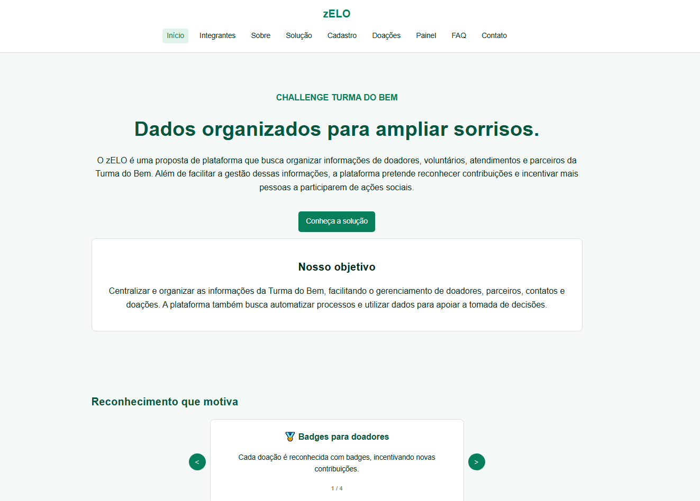
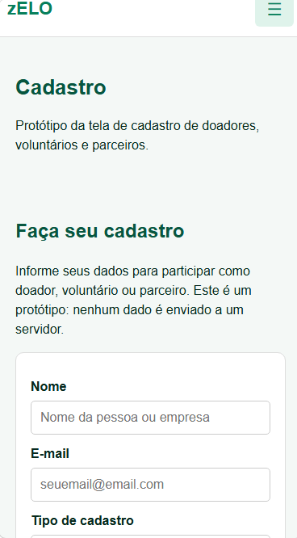
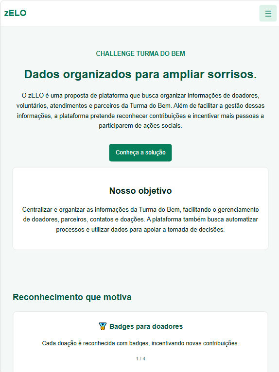
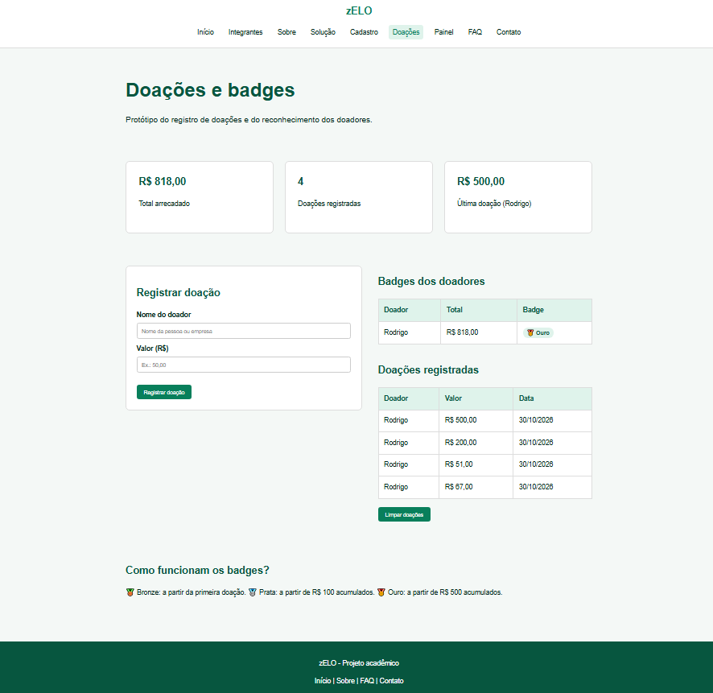
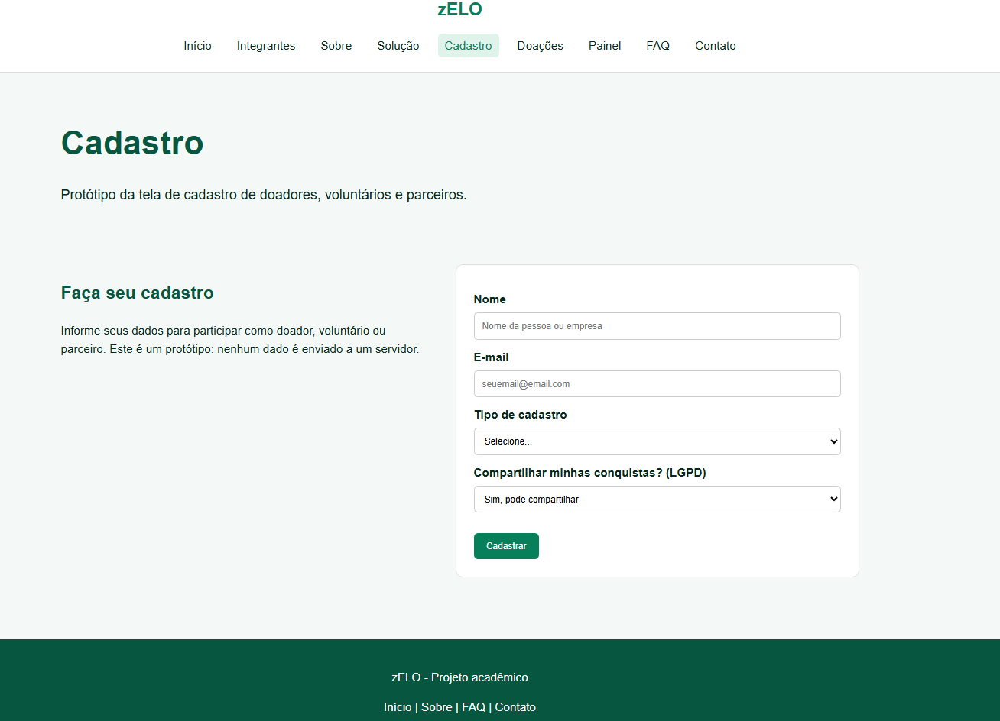

# zELO - README

Projeto acadêmico desenvolvido para o Challenge Turma do Bem.

**Link do repositório:** [COLOQUE AQUI O LINK DO REPOSITÓRIO NO GITHUB]

**Link para visualizar o site (GitHub Pages):** [COLOQUE AQUI O LINK DO SITE]

## Descrição

O zELO é uma proposta de plataforma que organiza as informações de doadores, voluntários, atendimentos e parceiros da Turma do Bem. Além de facilitar a gestão dessas informações, a plataforma pretende reconhecer contribuições, por meio de badges para doadores e certificados para voluntários, e incentivar mais pessoas a participarem de ações sociais.

O desafio do projeto é desenvolver uma plataforma que organize as informações da Turma do Bem, facilite a gestão de doadores e parceiros e incentive a participação contínua nas ações sociais. Para isso, a solução busca centralizar informações, organizar doações e contatos, automatizar processos, usar dados para apoiar decisões e proteger os dados pessoais de acordo com a LGPD.

Este projeto é um protótipo de site que apresenta a proposta. Os dados do painel são fictícios, o envio dos formulários de contato e de cadastro é apenas simulado e as doações registradas ficam salvas apenas no navegador.

## Páginas do site

O site possui nove páginas: Início (`index.html`), Integrantes (`integrantes.html`), Sobre (`sobre.html`), Solução (`solucao.html`), Cadastro (`cadastro.html`), Doações (`doacoes.html`), Painel (`painel.html`), FAQ (`faq.html`) e Contato (`contato.html`).

## Status da Sprint 02

A Sprint 02 está concluída. O site ficou responsivo para mobile, tablet e desktop, e foram implementadas interações com JavaScript, que fica em um arquivo externo dentro da pasta `js`.

## Funcionalidades implementadas

**Responsividade:** no desktop (acima de 1024px) foi mantida a estrutura da Sprint 01. Em telas de até 1024px, títulos e cards ficam menores. No tablet (até 768px), os cards passam a ser exibidos em duas colunas, as páginas de contato, cadastro e doações ficam com texto e formulário empilhados e o menu vira um menu hambúrguer. No mobile (até 600px), os cards ficam em uma coluna e os botões ocupam a largura total. Há ainda ajustes finos para telas de até 360px.

**Menu hambúrguer:** em telas de até 768px, o menu de navegação é substituído por um botão que abre e fecha a lista de links com um clique. Funciona em todas as páginas do site.

**Carrossel:** na página inicial, quatro slides apresentam badges, certificados, conquistas compartilháveis e privacidade. O usuário pode navegar pelas setas e os slides também trocam sozinhos a cada cinco segundos.

**Acordeão:** na página de FAQ, ao clicar em uma pergunta a resposta é exibida ou escondida.

**Validação do formulário:** na página de contato, o formulário confere se nome, e-mail e mensagem foram preenchidos corretamente, sem usar o atributo `required` do HTML. Quando há erro, o campo fica com a borda vermelha e aparece um aviso. O envio inválido é impedido com `preventDefault`, e quando tudo está correto aparece uma mensagem de sucesso.

**Cadastro:** na página de cadastro, o formulário recebe nome, e-mail, tipo de cadastro (doador, voluntário ou parceiro) e a escolha sobre compartilhar as conquistas (LGPD). A validação confere se o nome tem pelo menos três letras, se o e-mail é válido e se o tipo foi escolhido. Quando há erro, o campo fica com a borda vermelha e aparece um aviso; quando está tudo certo, aparece uma mensagem de sucesso. O cadastro é apenas simulado e não guarda dados.

**Doações e badges:** na página de doações, o usuário informa o nome do doador e o valor, e a doação é guardada no navegador com o `localStorage`. A página mostra o total arrecadado, a quantidade de doações, a última doação, a lista de doações (da mais nova para a mais antiga) e uma tabela com o badge de cada doador: Bronze a partir da primeira doação, Prata a partir de R$ 100 acumulados e Ouro a partir de R$ 500 acumulados. O botão Limpar doações apaga os registros.

**Feedback visual:** os botões têm efeito ao serem clicados e os cards ganham sombra quando o mouse passa sobre eles.

## Tecnologias utilizadas

HTML5, CSS3 (com Flexbox e media queries), JavaScript puro, Git e GitHub para controle de versão, e Visual Studio Code como editor.

## Estrutura de pastas

Na pasta principal do projeto ficam as nove páginas HTML e o arquivo README. A pasta `css` contém o arquivo `style.css`, a pasta `js` contém o arquivo `java.js`, a pasta `Imagens` contém as fotos dos integrantes e a pasta `prints` contém as imagens das telas do projeto.

```
projeto/
├── index.html
├── integrantes.html
├── sobre.html
├── solucao.html
├── cadastro.html
├── doacoes.html
├── painel.html
├── faq.html
├── contato.html
├── README.md
├── css/
│   └── style.css
├── js/
│   └── java.js
├── Imagens/
└── prints/
```

## Como executar

Baixe ou clone o repositório e abra o arquivo `index.html` no navegador. Para testar a responsividade, aperte F12 e depois Ctrl + Shift + M, ou diminua a largura da janela. O menu hambúrguer aparece em telas de até 768px.

## Autores

- **Arthur Prudencio Soares**, RM 569295, turma 1TDSPR. Função: Front-end. [LinkedIn](https://www.linkedin.com/in/arthur-prudencio-68a161391) | [GitHub](https://github.com/arthurpso2)
- **Davi Saldanha Gomes**, RM 574665, turma 1TDSPR. Função: IA. [LinkedIn](https://www.linkedin.com/in/davisaldanhagomes) | [GitHub](https://github.com/DaviS123444)
- **Pedro Henrique Paixão Luz**, RM 576237, turma 1TDSPR. Função: Python. [LinkedIn](https://www.linkedin.com/in/pedro-henrique-389960440) | [GitHub](https://github.com/Pedruka0)
- **Pedro Paulo Santos da Silva**, RM 568411, turma 1TDSPR. Função: Java. [LinkedIn](https://www.linkedin.com/in/pedro-santos-704b9b1b1) | [GitHub](https://github.com/PedroPaulo-03)
- **Rodrigo Cardoso Gabriel**, RM 574561, turma 1TDSPR. Função: Database. [LinkedIn](https://www.linkedin.com/in/rodrigo-gabriel-8319353b8) | [GitHub](https://github.com/Rcg42)

## Observações

Projeto de caráter acadêmico, sem fins comerciais. Os números do painel são fictícios e nenhum formulário (contato, cadastro ou doações) envia dados a um servidor. As doações ficam guardadas apenas no navegador (`localStorage`) e podem ser apagadas pelo botão Limpar doações.

## Contato

E-mail para contato: [RM574561@fiap.com.br]

## Imagens do projeto

### Página inicial



### Página inicial (Mobile)



### Página inicial (Tablet)



### Página de doação



### Página de cadastro


